# PrivX Inventory Import — Architecture & Data Flow

> **Last updated:** May 2026 — reflects current codebase including composite field types, translators, validators, update modes, and OAuth authentication.

## 1. High-Level Overview

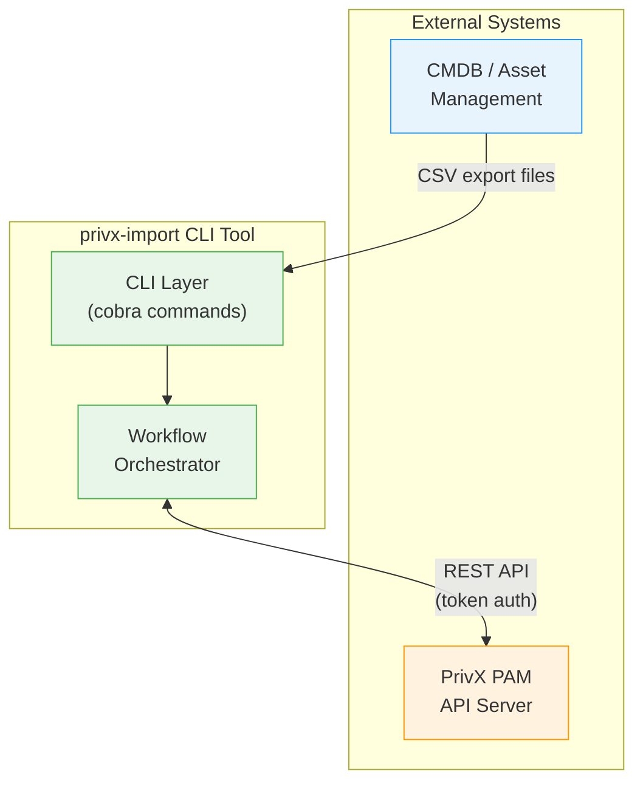

**Purpose:** `privx-import` is a CLI tool that synchronizes host inventory from CMDB exports (CSV files) into SSH.com's PrivX privileged access management system. It follows a plan-then-apply workflow similar to Terraform.

---

## 2. Complete Pipeline Architecture

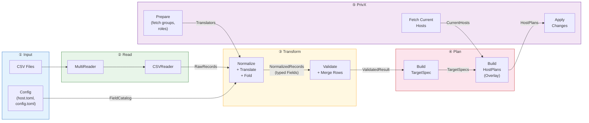

---

## 3. Package Dependency Graph

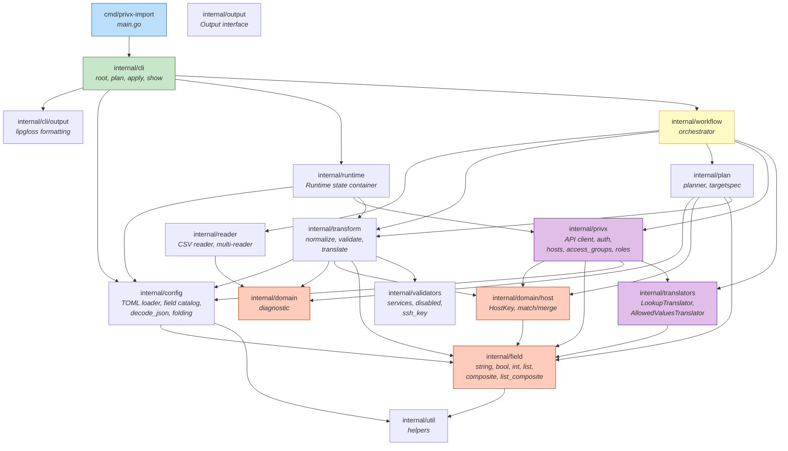

---

## 4. Detailed Data Flow (Sequence)

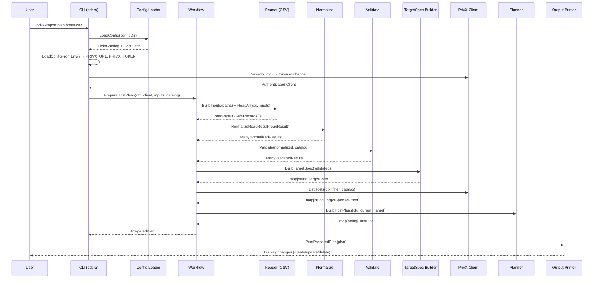

---

## 5. Apply Flow (with Confirmation)

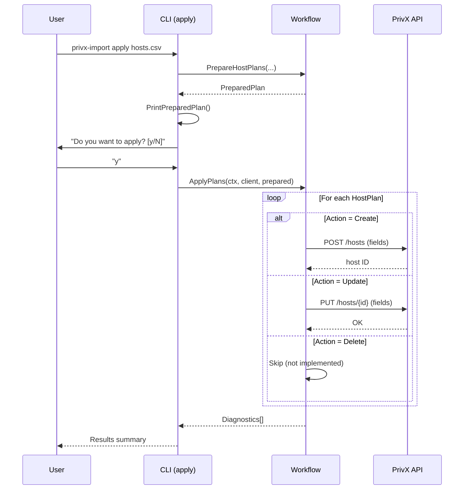

---

## 6. Data Transformation Pipeline (Record Level)

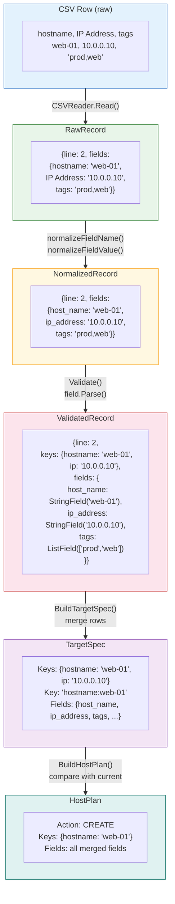

---

## 7. Field Type System

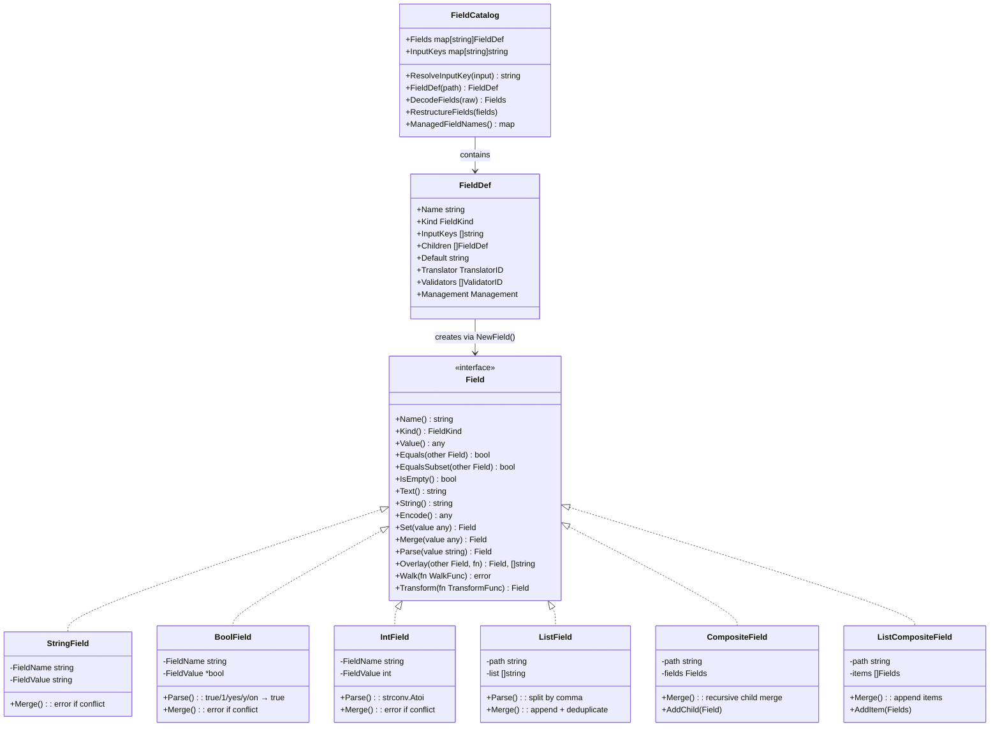

---

## 8. Host Identification & Matching

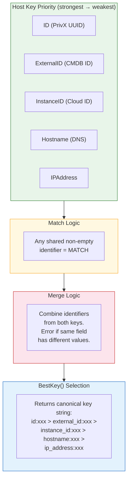

---

## 9. Multi-Row Merge Example

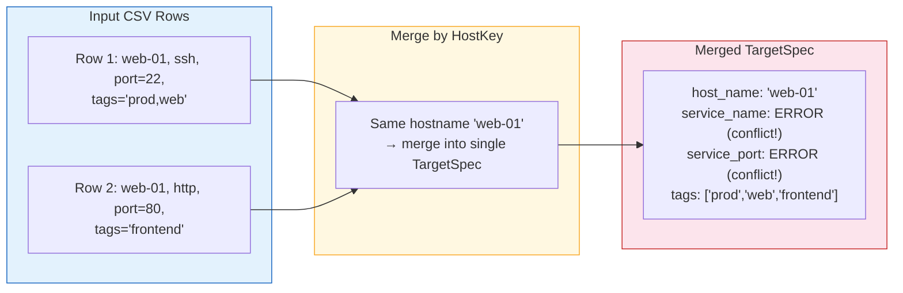

> **Note:** Scalar fields (string/bool) produce a conflict diagnostic when merged with different values. List fields merge by appending and deduplicating.

---

## 10. CLI Command Structure

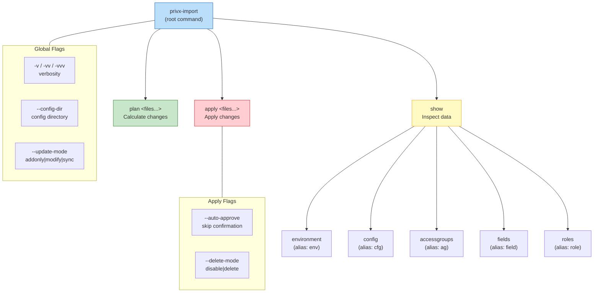

---

## 11. Error & Diagnostic System

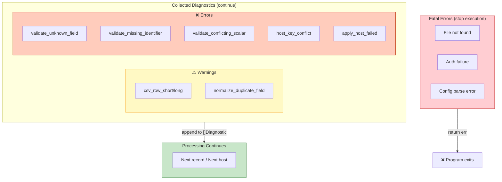

---

## 12. PrivX API Integration

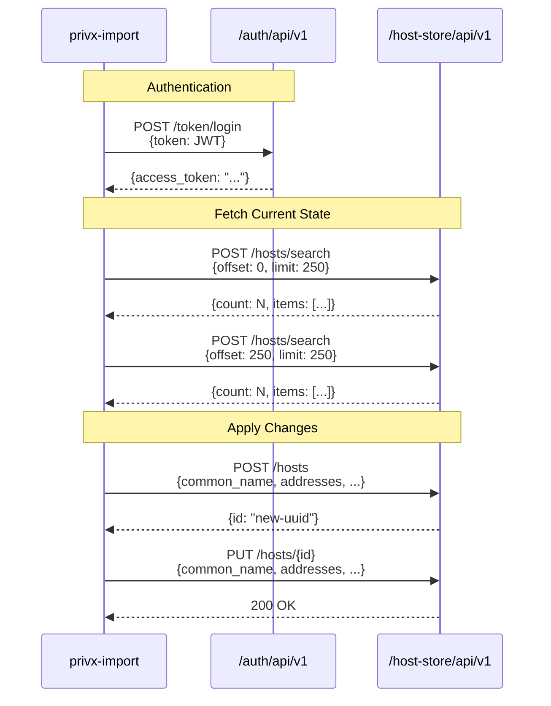

---

## 13. Configuration Files

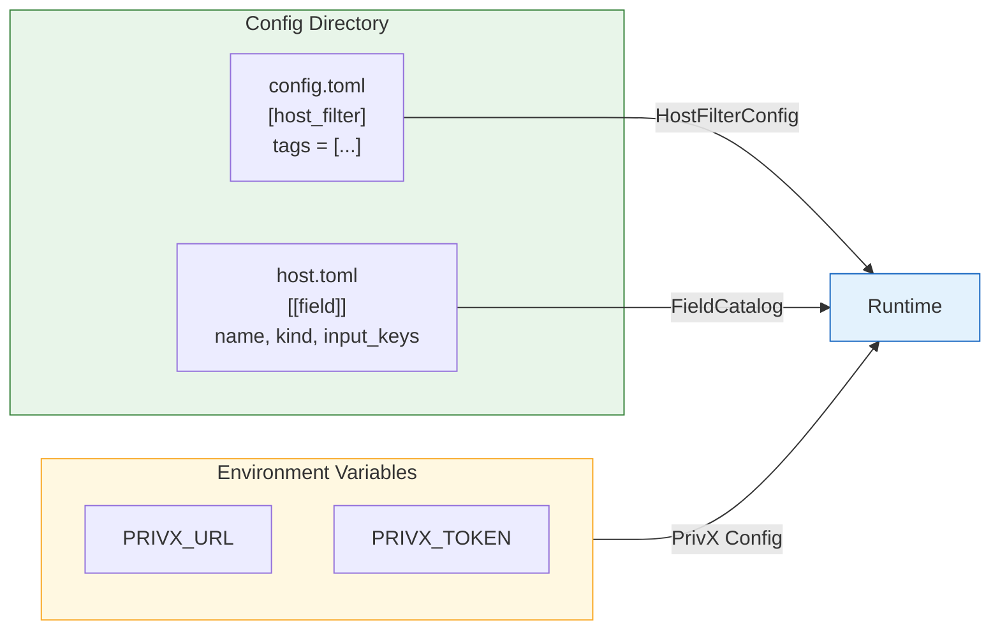

---

## Summary

| Phase | Package | Input | Output |
|-------|---------|-------|--------|
| **1. Init** | `cli`, `config`, `runtime` | CLI args, TOML files, env vars | Runtime (config, catalog, client) |
| **2. Prepare** | `workflow`, `privx` | PrivX API | Translators (access groups, roles, services) |
| **3. Read** | `reader` | CSV file paths | `ReadResult` (raw records) |
| **4. Normalize** | `transform` | Raw records + catalog + translators | `NormalizedResults` (typed Fields, translated, folded) |
| **5. Validate** | `transform`, `validators` | Normalized records + config | `ValidatedResult` (merged by host key, validated) |
| **6. Target** | `plan` | Validated records | `map[string]TargetSpec` (desired state) |
| **7. Current** | `privx` | PrivX API | `map[string]TargetSpec` (actual state) |
| **8. Plan** | `plan` | Target + Current + scope + update mode | `map[string]HostPlan` (create/update/delete) |
| **9. Apply** | `workflow`, `privx` | HostPlans + delete mode | API calls + diagnostics |

