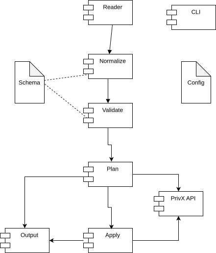

# Architecture

[Docs Index](README.md) · [Project README](../README.md)

The importer has been designed in a modular fashion.
This should make it easier to adapt it to

- import other entities in addition to hosts
- add validations
- add human friendly output lookups
- add input file types
- add new run environments (Web, API)
- alter the handling of diagnostics

See [Development document](development.md) for tips about altering the code.

## Context for major functions

These are the common context objects that are passed to major functions along the way.

- Context is the Go context that enables to cancel long lasting operations.
- Runtime object contains most of the environment that functions need.
- Config is the static configuration of the program behaviour
- Field catalog is the description of field types and the hierarchy of fields.
- Output handles all output.

## Output

Output handles all output. 

Note that it has a separate function for printing diagnostic messages. This could be used if there is need to collect diagnostic messages for further analysis.

Output has an interface at `internal/output/output.go`. This means that a Web app or an API, or testing, could create another implementation of Output, for example to log output to a file.

## Control flow

## Repository Structure

### Runtime packages

These directories correspond to Go runtime packages and roughly follow the execution flow of the application.

- `cmd/privx-import` — Application entry point that starts the CLI program.
- `internal/cli` — Cobra command definitions, flags, runtime initialization, and command dispatch.
- `internal/workflow` — High-level orchestration of import phases and diagnostic collection.
- `internal/reader` — Reads input sources such as CSV files and converts them into raw records.
- `internal/transform` — Normalization, translation, restructuring, and validation of imported data.
- `internal/validators` — Validation rules used during transform phase.
- `internal/translators` — Human ↔ machine value translators such as access group and role resolution.
- `internal/plan` — Builds target specifications and computes change plans against current PrivX state.
- `internal/apply` — Executes approved plans against PrivX APIs.
- `internal/privx` — PrivX API client, authentication, and API integrations.
- `internal/runtime` — Shared runtime context, loaded configuration, clients, and registries.
- `internal/output` — Console printing, formatting, dumps, diagnostics, and verbosity handling.

### Core model packages

These packages contain reusable domain structures and generic data handling logic.

- `internal/domain` — Shared domain models such as diagnostics and change tracking.
- `internal/domain/host` — Host-specific domain structures and matching logic.
- `internal/field` — Generic field system, field parsing, merge logic, and structured field handling.
- `internal/config` — TOML configuration loading, field catalog indexing, and configuration merging.
- `internal/util` — Generic helper functions with no internal project dependencies.

### Supporting directories

- `docs` — Project documentation and architecture notes.
- `docs/images` — Generated or static diagrams and documentation assets.
- `schemas` — OpenAPI schemas and related API definitions.
- `scripts` — Development helper scripts such as JWT token generation.
- `testdata` — Example CSV files and development test inputs.